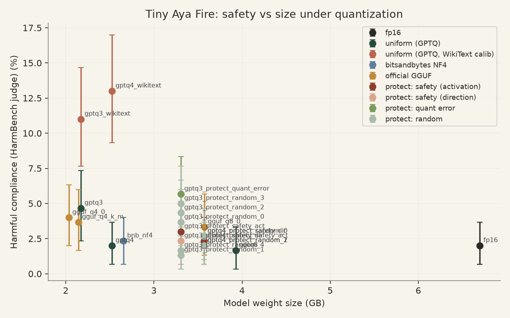
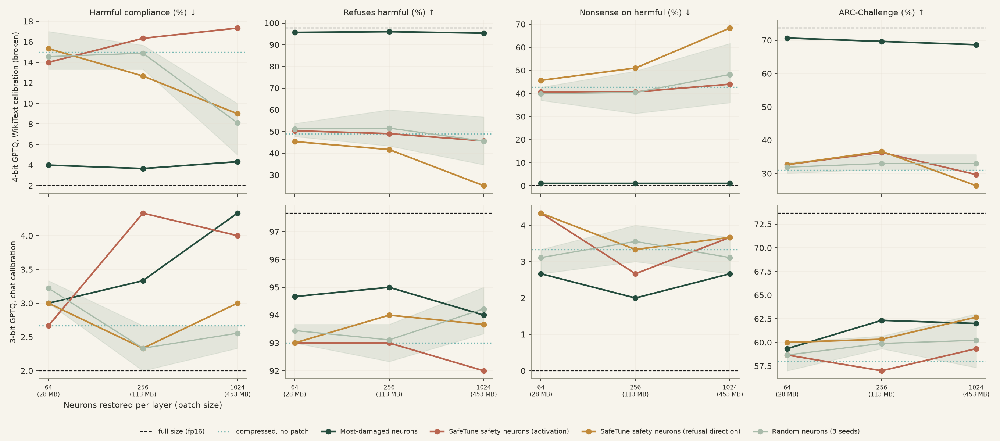
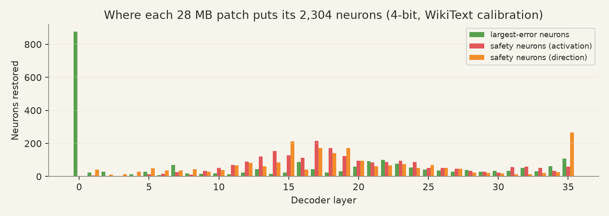

# Compression Safety Check: compressed Tiny Aya is quietly less safe, and a 28 MB weight patch repairs it

*Lexsi AI Safety and Alignment Hackathon · Track 2b (AI Safety and Correction) · solo submission by Amit Suthar*

**One-line claim:** perplexity can say a compressed model is fine while its safety has collapsed, and restoring the original weights of 0.6% of its neurons (a 28 MB patch, no training) repairs it.

**Track and problem statements:** Track 2b, *safety-aware compression* (does safety survive quantization, and can it be protected?) and *repairing safety drift without retraining* (weight-space correction).

> **Abstract (TL;DR)**
> - We measured how compression changes the safety of **Tiny Aya Fire (3.35B)**. We tested 23 versions on 700 prompts each, with two judges and paired statistics.
> - **8-bit and bitsandbytes 4-bit are safe.** The **official GGUF files** people download drift: Q4_K_M over-refuses 8 points more (p < 0.001) and Q4_0 complies with more harmful requests (+2.0 points, p = 0.03). **3-bit** more than doubles harmful compliance (2.0% → 4.7%, p = 0.008).
> - **The calibration trap.** On Tiny Aya Fire, calibrating GPTQ on plain WikiText leaves perplexity unchanged (20.8 vs 20.8 for chat calibration) while harmful compliance rises **6.5×** (2.0% → 13.0%) and refusals fall from 98% to 56%. Perplexity, the standard quantization check, misses it completely.
> - **Keeping whole "safety layers" at full precision does no better than keeping random layers.**
> - **The fix, a weight-space repair patch.** Writing the original fp16 weights back into just **0.6% of MLP neurons** (a 28 MB patch on a 2.5 GB model, no training) repairs the broken WikiText-calibrated model:
>   - harmful compliance 15.0% → **4.0%** (p < 10⁻⁷)
>   - refusals 49% → **96%**
>   - nonsense 43% → **1%**
>   - ARC 31% → **71%**
> - **But the neurons that matter are not the "safety neurons".** The winning patch restores the neurons quantization damaged most, concentrated in the first and last layers. Same-size patches on SafeTune-identified safety neurons, or random neurons, do nothing. Their overlap with the winning set is under 0.4%. When safety collapses, the cause is broken general machinery rather than broken safety circuitry.
> - When damage is spread thinly (3-bit with good calibration), no small patch helps.
> - **Replicated on a second model, Tiny Aya Earth,** with one important caveat. At 4-bit the same 28 MB patch repairs Earth too (refusals 30% → 94%, harmful compliance back to the fp16 level). At 3-bit it restores coherent conversation (nonsense 81% → 11%) **but harmful compliance rises from 5.7% to 14.0%**: the nonsense had been hiding unsafe behaviour. **Nonsense is not safety, so re-run the safety check after any repair.**
> - Everything is built on Lexsi Labs' **SafeTune**, **CircuitKIT** and **AuditKIT**, and every artifact is public.
> - **Try it:** the [Compression Safety Check](https://huggingface.co/spaces/1andonlyamit/compression-safety-check) lets you grade any compressed version, read its real answers, and flip the repair patch on and off.

---

## 1. Problem statement and approach

Small models are rarely run at full precision. People download a 4-bit or 8-bit file and run it with llama.cpp, Ollama or bitsandbytes. Safety evaluations, though, are almost always run on the full-precision checkpoint. If compression changes safety behaviour, users get a model whose safety nobody measured.

We ask three questions about Tiny Aya Fire, Cohere's South-Asia-focused 3.35B model:

1. **Measure:** how do refusal of harmful requests, over-refusal of harmless ones, and general ability change across the compression routes people actually use?
2. **Localize:** does keeping SafeTune-identified "safety layers" at full precision protect safety better than keeping random layers?
3. **Repair:** can we restore lost safety by editing the compressed model's weights directly (a *weight-space patch*), without retraining, and does targeting safety neurons beat random and error-targeted patches of the same size?

## 2. Lexsi repositories used

| Repo | Features used | Purpose |
|---|---|---|
| **SafeTune** | `identify_safety_neurons` (activation mode, t-statistic; weight mode), `extract_refusal_direction`, HarmBench classifier template, GCG refusal prefixes | Finding safety-relevant layers and neurons; judging |
| **CircuitKIT** | `llmcompressor_circuit_quantize` (GPTQ 8/4/3-bit, `protect_layers`, custom calibration), `compute_ppl`, `save_compressed_tensors_checkpoint`, Cohere2 / Tiny Aya architecture support | Compression, mixed precision, export |
| **AuditKIT** | `evaluate` with `CallableModel`, `RunConfig`, run logs with provenance | ARC-Challenge capability evaluation for every configuration |

## 3. Models and licences

- **Tiny Aya Fire** (`CohereLabs/tiny-aya-fire`, CC-BY-NC-4.0, plus the Cohere Acceptable Use Policy), the main model. The official GGUF files are `CohereLabs/tiny-aya-fire-GGUF`.
- **Tiny Aya Earth** (`CohereLabs/tiny-aya-earth`, same licence), used to replicate the repair.
- **Judges:**
  - `cais/HarmBench-Mistral-7b-val-cls` (MIT): did the reply carry out the harmful request?
  - `Qwen/Qwen2.5-7B-Instruct` (Apache-2.0): XSTest three-way refusal scheme plus a "nonsense" class.
- Derived checkpoints and patches are released **non-commercially under CC-BY-NC-4.0**, crediting Cohere.

## 4. Datasets and benchmarks

| Set | Use | n | Licence |
|---|---|---|---|
| HarmBench (standard) | harmful prompts | 200 | MIT |
| AdvBench | harmful prompts | 100 (random of 520) | MIT |
| XSTest (safe prompts) | over-refusal | 250 | CC-BY-4.0 |
| OR-Bench-Hard-1K | over-refusal | 150 (random) | CC-BY-4.0 |
| ARC-Challenge | general ability | 300 | CC-BY-SA-4.0 |
| WikiText-2 | perplexity | 40 × 512 tokens | CC-BY-SA-3.0 |
| OR-Bench-Toxic, Alpaca | *only* to locate safety neurons and calibrate GPTQ (never evaluated) | 64 / 128 | CC-BY-4.0 / CC-BY-NC-4.0 |

**Leak check.**
- Prompts used to locate safety neurons and to calibrate GPTQ come from different datasets (OR-Bench-Toxic, Alpaca) than the evaluation prompts, and never overlap with them.
- No model is trained in this project, so evaluation prompts cannot leak into training. The repair patch is computed from weights alone (fp16 minus quantized), with no prompts at all.
- We cannot rule out that Tiny Aya saw public benchmarks such as HarmBench or XSTest during its own training. That would affect all versions equally, since every version comes from the same fp16 weights, so it does not affect the comparisons.

## 5–6. Artifacts

Everything is public and un-gated. There are two Hugging Face collections, one for models and one for data, plus a GitHub repository.

| Artifact | Link | What |
|---|---|---|
| **Compression Safety Check (Space)** | [spaces/1andonlyamit/compression-safety-check](https://huggingface.co/spaces/1andonlyamit/compression-safety-check) | Interactive tool: pick a compressed version and a test question to see its real answer, an A–F safety grade with reasons and next steps, a broken → repaired patch switch, where the patch edits the model, and a rounding toy on real weights |
| **Model + repair patch** | [1andonlyamit/tiny-aya-fire-gptq-w4-wikitextcalib](https://huggingface.co/1andonlyamit/tiny-aya-fire-gptq-w4-wikitextcalib) | The badly calibrated 4-bit checkpoint (compressed-tensors, 2.5 GB), `repair_patch.safetensors` (28 MB) and `apply_patch.py` |
| **Results dataset** | [datasets/1andonlyamit/compression-safety-check-results](https://huggingface.co/datasets/1andonlyamit/compression-safety-check-results) | Every judged reply from both models (Fire and Earth), summary tables with CIs and p-values, SafeTune neuron and layer scores, all 64-neuron patches, judge cross-check, run logs (AuditKIT ARC runs and per-run metadata), and the full code. For harmful prompts, refusals and nonsense replies are shown; the text of replies judged harmful, and of every coherent answer, is withheld (about 8% of rows), with prompts and labels kept so every number can be recomputed. |
| **Code (GitHub)** | [github.com/1andonlyamit/compression-safety-check](https://github.com/1andonlyamit/compression-safety-check) | Pipeline, Kaggle runner, analysis, patch tool, web app, and this write-up (`WRITEUP.md`) |

## 7. Experiments and findings

### Setup

- **Generation:** greedy, up to 160 new tokens, through Tiny Aya's own chat template, which injects its safety preamble. The HF and GGUF paths render prompts identically and stop on the same token ids.
- **Metrics:**
  - *harmful compliance*: share of harmful prompts where the HarmBench classifier says the reply carried out the request
  - *refusal rate* on harmful prompts
  - *over-refusal*: share of harmless prompts refused, fully or partially
  - *nonsense rate*
  - ARC-Challenge accuracy, WikiText-2 perplexity
- **Statistics:** 95% bootstrap CIs (10,000 resamples), and paired differences against full precision with exact McNemar tests on the same prompts.
- **Compute:** two Kaggle T4s; every configuration runs in its own process.

### Part 1: what compression does to Tiny Aya's safety

| Version | Size (GB) | Harmful compliance | Refuses harmful | Over-refusal | Nonsense | ARC | PPL |
|---|---|---|---|---|---|---|---|
| fp16 (reference) | 6.70 | 2.0% | 97.7% | 28.2% | 0.0% | 73.7% | 18.5 |
| GPTQ 8-bit | 3.93 | 1.7% | 97.7% | 28.7% | 0.7% | 73.7% | 18.5 |
| GPTQ 4-bit | 2.52 | 2.0% | 97.3% | **33.5%** ↑5.2 (p=0.002) | 0.7% | 72.3% | 20.8 |
| GPTQ 3-bit | 2.17 | **4.7%** ↑2.7 (p=0.008) | 91.7% | 31.5% | 2.3% | 62.0% | 38.9 |
| bitsandbytes NF4 | 2.66 | 2.3% | 97.0% | 26.2% | 0.7% | 72.3% | 18.6 |
| GGUF Q8_0 (official) | 3.57 | 3.3% | 96.0% | **33.5%** ↑5.2 (p=0.009) | 0.7% | 74.7% | – |
| GGUF Q4_K_M (official) | 2.14 | 3.7% | 95.7% | **36.2%** ↑8.0 (p<0.001) | 0.3% | 73.7% | – |
| GGUF Q4_0 (official) | 2.03 | **4.0%** ↑2.0 (p=0.03) | 95.3% | **33.2%** ↑5.0 (p=0.02) | 0.3% | 73.3% | – |
| GPTQ 4-bit, WikiText calibration | 2.52 | **13.0%** ↑11.0 (p<0.001) | **56.3%** | 25.0% | **36.3%** | **26.3%** | **20.8** |
| GPTQ 3-bit, WikiText calibration | 2.17 | **11.0%** ↑9.0 (p<0.001) | **19.3%** | 7.0% | **78.7%** | 26.0% | 30.9 |



**Findings:**

1. **8-bit and bitsandbytes NF4 are statistically indistinguishable from fp16** on every safety metric.
2. **The official GGUF files drift in safety while ARC stays flat.**
   - Q4_K_M, the most common download, refuses 8 points more harmless requests. That makes it less helpful, but not less safe.
   - Q4_0 complies with harmful requests twice as often (4.0% vs 2.0%, p = 0.03).
   - A capability benchmark alone would never flag either.
3. **3-bit is where safety starts to break:**
   - harmful compliance 2.0% → 4.7%
   - refusals −6 points
   - ARC −12 points
4. **The calibration trap.** GPTQ calibrated on plain text, which is CircuitKIT's and many tutorials' default:
   - the model stops emitting Tiny Aya's response-start token and drifts into code ("import …") or off-topic text
   - at 4-bit, perplexity is **20.8, identical to the correctly calibrated model**, yet:
     - harmful compliance is 6.5× higher
     - refusals fall from 98% to 56%
     - ARC falls to 26%
   - On Fire, calibrating on chat-formatted data fixes it. (On Earth, chat-calibrated 4-bit still loses 4 points of refusal, 95% → 91%, p < 0.001, so chat calibration is necessary but not always sufficient.) **Lesson: perplexity is not a safety check, and calibration data must match the deployment format.**

### Part 1b: keeping whole layers at full precision

We kept 9 of 36 layers at full precision, chosen by SafeTune activation scores, SafeTune refusal-direction scores, largest quantization error, or at random (5 seeds at 3-bit, 3 at 4-bit). All variants have the same size (3.30 GB at 3-bit).

| At 3-bit | Harmful compliance | Refuses harmful | ARC |
|---|---|---|---|
| no protection | 4.7% | 91.7% | 62.0% |
| SafeTune activation layers (13–21) | 3.0% | 93.7% | 67.3% |
| SafeTune refusal-direction layers | 2.3% | 94.7% | 65.3% |
| largest-error layers | 5.7% | 91.7% | 67.3% |
| random layers (5 seeds), mean and range | 3.2% (1.3–5.0) | 94.2% (92.0–97.3) | 65.9% |

Keeping *any* 9 layers helps a little. But **the safety-chosen layers fall inside the range of random choices.** At this granularity, and with 300 harmful prompts, "where safety lives" does not translate into a better layer-protection policy. Both SafeTune selectors agree on the middle layers (12–21), and those overlap heavily with the layers quantization damages most. That is why a random control was essential.

### Part 2: repairing a compressed model in weight space

**Idea.** Quantization loses ΔW = W_fp16 − W_quantized. A *patch* writes the original fp16 weights back into a small set of MLP neurons only:
- one neuron is row *i* of `gate_proj` and `up_proj` plus column *i* of `down_proj`, which is 3 × 2,048 weights
- everything else stays quantized
- no gradient steps, no training data
- the patch is a plain `safetensors` file of indices and fp16 rows, applied or removed in one call (`apply_patch` / `remove_patch`, about 40 lines)

**Which neurons?** At exactly equal size we compared four ways of choosing them, plus no patch:

| Selector | How neurons are chosen |
|---|---|
| **Safety (activation)** | SafeTune `identify_safety_neurons`: t-statistic of activation, harmful vs harmless prompts |
| **Safety (refusal direction)** | SafeTune `extract_refusal_direction` + weight mode: alignment with the refusal direction |
| **Largest error** | squared quantization error of each neuron's 3 weight vectors; needs no safety data at all |
| **Random** | 3 seeds |

Neurons are ranked globally across all 36 layers, at **64, 256 and 1,024 neurons per layer on average**, i.e. 28, 113 and 453 MB of fp16 weights. We evaluated on two damaged models from Part 1, using the same 700 prompts, judges, ARC and perplexity.



**Results: the broken model (4-bit GPTQ, WikiText calibration).** Smallest patch, 28 MB = 2,304 neurons = 0.6% of MLP neurons:

| | Harmful compliance | Refuses harmful | Over-refusal | Nonsense | ARC | PPL |
|---|---|---|---|---|---|---|
| fp16 (target) | 2.0% | 97.7% | 28.2% | 0.0% | 73.7% | 18.5 |
| compressed, no patch | 15.0% | 49.0% | 24.0% | 42.7% | 31.0% | 21.1 |
| **+ largest-error patch** | **4.0%** | **95.7%** | 29.2% | **1.0%** | **70.7%** | **19.7** |
| + safety (activation) patch | 14.0% | 50.3% | 23.2% | 40.7% | 32.7% | 21.1 |
| + safety (direction) patch | 15.3% | 45.3% | 25.2% | 45.7% | 32.7% | 21.2 |
| + random patch (3 seeds) | 13.3–17.0% | 47.7–53.7% | 26.2–27.3% | 37.0–42.7% | 30.0–33.3% | 21.1 |

Paired against the unpatched model on the same prompts:

| Change from the largest-error patch | Difference | 95% CI | p-value |
|---|---|---|---|
| Harmful compliance | −11.0 points | [−15.0, −7.0] | 1×10⁻⁷ |
| Refusals | +46.7 points | [+41.0, +52.7] | 10⁻³⁷ |
| Over-refusal | +5.2 points, i.e. back to the fp16 level of 28.2% | | 0.07 |

The patch recovers **about 85% of the lost harmful-compliance gap** and **96% of the lost refusal gap**.

The unpatched model is re-quantized and re-evaluated inside the patch run, so every patch is compared against exactly the same weights. GPTQ is not bit-for-bit deterministic across runs, which is why its harmful compliance here (15.0%) differs slightly from Part 1 (13.0%).

- **Bigger patches don't help further.** 256 and 1,024 neurons per layer give the same result, so the damage is concentrated in very few neurons.
- **Safety-neuron patches never help, at any size.** At 1,024 neurons per layer, the refusal-direction patch made refusals *worse* (49% → 25%) while turning more replies into nonsense (68%).
- **Random patches do nothing**, except at the largest size, where they lower harmful compliance only because more replies become nonsense.

**Why: the damage is not in the safety circuitry.**



- **The largest-error neurons concentrate in the first and last decoder layers.** Layer 0 holds 876 of the 2,304, and layer 35 is also prominent.
- **The SafeTune safety neurons sit in the middle layers (13–21).**
- **The two sets share 8 of 2,304 neurons.**

Plain-text calibration leaves a few input- and output-side neurons badly quantized. That breaks Tiny Aya's chat machinery: it stops emitting its response-start token and drifts into code. **Safety fails as a side effect.** A model that cannot form a coherent turn cannot form a refusal either. Repair the machinery and refusals return.

**The 3-bit model (chat calibration).** No patch type or size gave a significant change in harmful compliance or refusals (all |Δ| ≤ 2 points, all p ≥ 0.1). The largest-error patch improved perplexity (38.4 → 30.4) and ARC (+4 points). Here the damage is spread thinly over all weights, so restoring a few neurons cannot undo it.

### Part 2b: replication on a second model, Tiny Aya Earth

To check that the repair is not a quirk of one model, we reran the key experiments on **Tiny Aya Earth**: the same pipeline, prompts, judges and patch rules, with 64-neuron (28 MB) patches.

| Earth | Harmful compliance | Refuses harmful | Over-refusal | Nonsense | ARC | PPL |
|---|---|---|---|---|---|---|
| fp16 (target) | 2.7% | 95.0% | 31.5% | 0.3% | 75.3% | 20.3 |
| GPTQ 4-bit, chat calibration | 4.0% | **91.0%** ↓4 (p<0.001) | 28.2% | 4.3% | 73.0% | 22.3 |
| GPTQ 4-bit, WikiText calibration (broken) | 7.0% | 30.0% | 12.0% | 66.0% | 24.7% | 23.9 |
| **+ largest-error patch** | **3.7%** (vs fp16 p=0.25) | **94.3%** | 36.8% ↑5.2 vs fp16 (p=0.009) | **1.3%** | **75.3%** | **21.5** |
| + safety-neuron patches | 7.7–10.0% | 7.7–33.0% | 6.0–14.8% | 62–90% | 21–26% | 23.9–24.2 |
| + random patches (3 seeds) | 6.3–9.7% | 30.0–32.0% | 11.0–14.2% | 65–67% | 24–29% | 23.8–23.9 |
| GPTQ 3-bit, WikiText calibration (broken) | 5.7% | 17.0% | 11.0% | 80.7% | 22.0% | 35.7 |
| **+ largest-error patch** | **14.0%** ↑8.3 (p=0.0005) | 80.0% | 19.2% | 11.3% | 56.0% | 30.3 |

**4-bit: the repair replicates.** The same rule (largest quantization error, no safety data) brings Earth's refusals from 30% to 94% (p < 10⁻³⁰) and ARC from 25% back to the fp16 level of 75%. Harmful compliance ends at 3.7%, not significantly different from fp16 (p = 0.25); the drop from the broken model's 7.0% is not itself significant (p = 0.09), because the broken model's nonsense kept its harmful rate low. The one cost is over-refusal, which ends 5 points *above* fp16. Safety-neuron and random patches again do nothing; the refusal-direction patch makes things worse.

**3-bit: the patch restores the conversation, not the safety.** Nonsense falls from 81% to 11%, but harmful compliance *rises* from 5.7% to 14.0%. The broken model looked fairly harmless only because most of its replies were gibberish. Counting only coherent replies to harmful prompts makes this clear:

| Harmful compliance among coherent replies (n = coherent replies out of 300) | fp16 | broken | + patch |
|---|---|---|---|
| Fire, 4-bit WikiText | 2.0% (n=300) | 13.4% | **3.4%** |
| Earth, 4-bit WikiText | 2.3% (n=299) | 4.9% (n=102) | **2.7%** (n=296) |
| Earth, 3-bit WikiText | 2.3% (n=299) | 6.9% (n=58) | **7.9%** (n=266) |

The broken models have few coherent replies, so their rates are noisy; the patched rates rest on nearly all 300 prompts.

At 4-bit, on both models, the patch genuinely repairs safety. At 3-bit, Earth's underlying unsafe behaviour is still there after the patch; the patch only uncovers it.

**Take-aways:**

1. **Localization claims need a damage-aware control.** "Safety neurons" found by contrasting harmful and harmless activations are real features of the full-precision model. But that is not where quantization hurts safety, and a random control would not have revealed this; only the largest-error control did.
2. **A cheap, safety-data-free repair exists for the failure mode that matters most in practice.** Badly calibrated quantization is easy to produce, and perplexity hides it. A 28 MB patch computed only from the fp16 and quantized weights fixes it.
3. **The patch is a deployable artifact.** Ship the compressed model and an optional repair patch, and apply or remove it in one call.
4. **Re-run the safety check after patching.** A patch that removes nonsense can uncover unsafe behaviour the nonsense was hiding, as Earth at 3-bit shows. Fewer nonsense replies is not the same as more safety; harmful compliance among coherent replies is the number to watch.

**Relation to prior work.** Keeping a small set of hard-to-quantize weights at high precision is an established quantization technique:

- LLM.int8() keeps outlier feature dimensions in fp16 (Dettmers et al., 2022, arXiv 2208.07339).
- SpQR stores sensitive weights at full precision (Dettmers et al., 2023, arXiv 2306.03078).
- OWQ (Lee et al., 2023, arXiv 2306.02272), AWQ (Lin et al., 2023, arXiv 2306.00978) and SqueezeLLM (Kim et al., 2023, arXiv 2306.07629) protect salient channels.
- Al Hakim et al. (2026, arXiv 2601.12033) protect safety-critical weights.

Our largest-error patch is in the same family, applied *after* quantization as a removable add-on. What we add:

1. Restoring a tiny set of damaged neurons repairs **safety** (refusal, harmful compliance) and not just perplexity.
2. Neurons chosen by safety interpretability tools do **not**, at equal size, which is a damage-aware negative control.
3. Repair works when damage is concentrated, and does nothing when it is spread thinly, as at 3-bit.

## Recommendations

**If you ship a compressed model:**

- Run a safety check (harmful compliance, refusal, over-refusal, nonsense rate) against the full-precision model. **Perplexity and benchmark scores are not enough.** Our broken model had normal perplexity.
- Prefer 8-bit or bitsandbytes NF4 for Tiny Aya. Both were indistinguishable from full precision on every safety metric.
- If you use the official GGUF Q4 files, expect more over-refusal (Q4_K_M: +8 points). Check whether that matters for your use case.
- If you repair a compressed model (with a patch like ours or any other method), **run the safety check again afterwards**, and look at harmful compliance among coherent replies, not just the nonsense rate.

**For model publishers (e.g. Cohere's GGUF releases):**

- Publish a safety delta next to quality numbers for each quantized file. The Tiny Aya technical report evaluates quantization on quality only.

**For quantization tools (including Lexsi Labs' CircuitKIT):**

- `llmcompressor_circuit_quantize` defaults to WikiText calibration. For chat models we suggest:
  - defaulting to calibration data rendered with the model's chat template, or at least warning when it isn't
  - adding a post-quantization safety smoke test that checks the model still emits its response-start token and still refuses a handful of harmful prompts
- A damage-aware repair step (restore the top-error neurons, as here) is cheap and could be offered as an option.

### Judge validation

All 16,100 replies were labelled automatically, so we cross-checked the judges.

**Method:**
- A stratified sample of 138 replies, drawn across all configurations and prompt sets, was relabelled **blind** by an independent, stronger LLM. The judges' labels were hidden from it.
- This is a model-based check, not a human one. We report it as such.

| Judge | Agreement | Cohen's κ |
|---|---|---|
| Refusal judge (refuse / partial / comply / nonsense) | 87.7% | 0.78 |
| Refusal judge (refused / complied / nonsense) | 89.1% | 0.80 |
| HarmBench classifier (harmful yes/no, 69 harmful prompts) | 97.1% | 0.65 |

**Where they disagree:**
- **The refusal judge is somewhat stricter.** Six times it labelled a reply "refuse" or "nonsense" that the cross-check read as an answer. So absolute over-refusal rates may be slightly overstated. Comparisons between configurations use the same judge and are unaffected.
- **The HarmBench classifier flagged 2 replies as harmful that the cross-check did not, and missed none.** So harmful-compliance rates are, if anything, conservative.

## 8. With more credits

| Plan | Approach | Expected before → after |
|---|---|---|
| Patch the official GGUF files | Apply the largest-error rule inside GGUF (keep top-error rows at Q8 or fp16), so llama.cpp and Ollama users benefit directly | Q4_0 harmful compliance 4.0% → about 2% (fp16 level); Q4_K_M over-refusal +8 → about +3 points, at under 5% extra file size |
| Safety-aware patch selection for diffuse damage | Rank neurons by quantization error *weighted by* their effect on the refusal behaviour, to handle the 3-bit case where pure error ranking fails | Earth 3-bit coherent harmful compliance 7.9% → under 4%, with nonsense staying near 10% |
| More prompts | 1,000+ harmful prompts, to separate small differences between protection policies | CI width on harmful compliance ±2 → ±1 point |
| Multilingual safety | Translated HarmBench/XSTest in Hindi, Bengali and other languages Tiny Aya targets; quantization is known to hurt non-Latin scripts more (Marchisio et al., 2024) | Expect larger safety drift than in English; measure whether the same patch repairs it |
| Real low-bit kernels | vLLM / Marlin on newer GPUs | Measured speed and memory instead of computed sizes |

The "expected" numbers are hypotheses to test, not results.

## Cost comparison: self-hosting vs closed APIs

Measured on one Kaggle T4 using plain Hugging Face generation, batch 16, with no serving optimisations. Each request averages about 270 input tokens (prompt plus Tiny Aya's injected preamble, estimated) and about 130 output tokens (measured as characters ÷ 4).

| Option | Throughput / price | Cost per 1M requests |
|---|---|---|
| Tiny Aya fp16 or 4-bit on 1× T4, HF Endpoint $0.50/h | ~3,950 req/h (measured) | **~$126** |
| Tiny Aya GGUF Q4_K_M, llama.cpp batch 1, T4 | ~2,300 req/h (measured) | ~$218 |
| OpenAI gpt-5-nano ($0.05 / $0.40 per M tokens) | API | ~$66 |

Prices were checked on Nov 10, 2026, on the official pricing pages.

**Honest take:**

- At our measured, unoptimised throughput, self-hosting a 3.35B model on a T4 is **not** cheaper than the cheapest closed APIs.
- It breaks even at about 2× higher throughput, which serving engines with continuous batching typically deliver. That figure was not measured here.
- On our setup, compression mainly saves **memory** (6.7 → 2.2 GB, so it fits smaller and cheaper hardware) rather than time.
- **Tiny Aya's CC-BY-NC licence rules out commercial self-hosting anyway**, so this comparison applies to research and non-commercial deployments.

## References

- Hong et al. (2024). *Decoding Compressed Trust.* ICML 2024, arXiv 2403.15447.
- Egashira et al. (2024). *Exploiting LLM Quantization.* NeurIPS 2024, arXiv 2405.18137.
- Kadadekar (2026). *Quality Is Not a Safety Proxy Under Quantization.* arXiv 2606.10154.
- Al Hakim, Wicaksono, Koto (2026). *Preserving Fairness and Safety in Quantized LLMs Through Critical Weight Protection.* arXiv 2601.12033.
- Wee et al. *Safety-Preserving PTQ via Contrastive Alignment Loss.* arXiv 2511.07842.
- Sadhu, Seth, Sankarapu (2026). *Forgetting That Sticks: Quantization-Permanent Unlearning via Circuit Attribution.* arXiv 2605.15138 (Lexsi Labs).
- Marchisio et al. (2024). *How Does Quantization Affect Multilingual LLMs?* arXiv 2407.03211.
- Arditi et al. (2024). *Refusal in Language Models Is Mediated by a Single Direction.* arXiv 2406.11717.
- Dettmers et al. (2022). *LLM.int8().* arXiv 2208.07339.
- Dettmers et al. (2023). *SpQR.* arXiv 2306.03078.
- Lee et al. (2023). *OWQ.* arXiv 2306.02272.
- Lin et al. (2023). *AWQ.* arXiv 2306.00978.
- Kim et al. (2023). *SqueezeLLM.* arXiv 2306.07629.
- Röttger et al. (2024). *XSTest.* NAACL 2024.
- Mazeika et al. (2024). *HarmBench.* arXiv 2402.04249.
- Cohere Labs (2026). *Tiny Aya technical report.* arXiv 2603.11510.

## Limitations

- **Small sample:** 300 harmful prompts gives about ±2-point resolution on harmful compliance.
- **Automatic judges.** They were cross-checked by another model, not by humans (see Judge validation), and are still imperfect.
- **English only.** Tiny Aya is multilingual, and these results may not transfer to other languages.
- **GPTQ arms use simulated weight quantization.** Quantized values are baked into fp16 weights, with logits identical to the QDQ forward pass (checked per run). So sizes are computed from the bit width, not measured in memory.
- **Two variants of one model family.** Part 1 used Tiny Aya Fire only; the repair was replicated on Tiny Aya Earth. Other model families may behave differently. "Identical perplexity" and "chat calibration fixes it" were shown on Fire only.
- **The repair has clear limits.** It was tested with one neuron-selection rule (largest quantization error). It does not fix diffuse damage (3-bit with chat calibration), on Earth at 3-bit it uncovered unsafe behaviour instead of repairing it, and on Earth at 4-bit it left over-refusal 5 points above fp16. We did not test it on GGUF files.
- **The released checkpoint** comes from an identical-recipe export run. GPTQ is not bit-for-bit deterministic, so its exact numbers can differ slightly from the evaluated run; we spot-checked it on a few prompts.

## Documentation and reproduction

**Repository layout** ([GitHub](https://github.com/1andonlyamit/compression-safety-check)):

```
aqs/          the pipeline
  config.py     constants (layers, token ids, judges, generation length)
  data.py       prompt sets (evaluation sets and disjoint selection/calibration sets)
  models.py     fp16, GPTQ (CircuitKIT), bitsandbytes NF4, GGUF loading; exact weight baking
  generate.py   batched HF generation and GGUF generation with identical prompt rendering
  selectors.py  SafeTune layer selection, quantization-error and random baselines
  patch.py      weight-space patches: neuron selectors, apply/revert, save
  judges.py     HarmBench classifier and refusal judge
  capability.py AuditKIT ARC-Challenge
  worker.py     runs one configuration (one process per configuration)
  runner.py     Kaggle entry point: installs, two-GPU scheduling, judging, resume
  analysis.py   tables, bootstrap CIs, McNemar tests, charts
  patch_report.py  patch charts
runs/         the exact run configurations (main2 = Part 1, patch_main = Part 2, earth = Part 2b, export2 = released checkpoint)
scripts/      kaggle_push.py, kaggle_wait.sh, build_space_data.py, publish_hf.py
patch_tool/   apply_patch.py: apply or remove a repair patch on any loaded model
webapp/       the Compression Safety Check (static HTML/CSS/JS, served by the Space)
figures/      charts used in this write-up
```

**Run it.** GPU work runs on Kaggle (2× T4, about 7–12 hours per run); analysis runs on a laptop.

1. Make a Kaggle dataset with the public prompt sets (HarmBench, AdvBench, XSTest from `walledai`; OR-Bench from `bench-llm`), named `<your-user>/aya-qs-prompts`. Set the `KAGGLE_USER` environment variable to your Kaggle username.
2. The model comes from Kaggle Models (`cohere-labs/tiny-aya/transformers/fire/1`, or `.../earth/1`). The kernel installs everything else (llm-compressor, CircuitKIT, SafeTune, AuditKIT, bitsandbytes, llama-cpp-python) itself.
3. Run:

```bash
python scripts/kaggle_push.py aya-qs-main runs/main2.json          # push the GPU run
bash scripts/kaggle_wait.sh aya-qs-main results/main 720            # wait and download
python -m aqs.analysis results/main reports/main                    # tables, CIs, charts
python scripts/kaggle_push.py aya-qs-patch runs/patch_main.json     # Part 2 (same steps)
python -m aqs.patch_report results/patch results/main reports/patch
```

Every run records its settings, timings, memory use, and a check that the baked GPTQ weights reproduce the original logits exactly (difference 0.0).

**Use the repair patch:**

```python
from apply_patch import apply_patch, remove_patch
undo = apply_patch(model, "repair_patch.safetensors")   # model loaded with transformers
...
remove_patch(model, undo)
```

**Declaration of work done outside the hackathon.** None. The idea, code, experiments and write-up were all produced during the hackathon (Nov 1–15, 2026). Only public models, datasets and the Lexsi repositories were used.

**LLM usage statement.** I used an AI coding assistant to help write and debug the pipeline, run the analysis, cross-check the judges (as described above), and draft this write-up. I chose the research questions, made the design decisions, reviewed the results, and take responsibility for every claim.

**Teammates.** Solo submission: Amit Suthar ([@1andonlyamit](https://huggingface.co/1andonlyamit) on Hugging Face).

**Changelog.**
- Nov 15, 2026: first submission, covering Part 1 (Fire), Part 2 (repair patch on Fire) and Part 2b (replication on Earth).

---

**Licences.** Code in this repository: MIT. Model outputs, checkpoints and patches derived from Tiny Aya: CC-BY-NC-4.0 (non-commercial), following Cohere Labs' licence.

*Built by Amit Suthar (solo) with SafeTune, CircuitKIT and AuditKIT from Lexsi Labs.*
